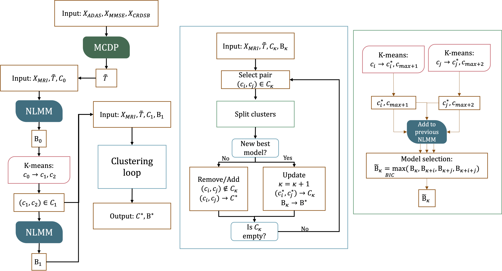

# Latent time-shift clustering of Alzheimer's disease patients

This repository contains the latent time-shift clustering (LTC) method used in the publication [Data-driven clustering of atrophy patterns in Alzheimer's disease.](https://rdcu.be/VTjMeRJ58Bca). The method aligns participants along an estimated disease timeline based on the [MCDP model](https://github.com/larslau/progmod), then groups them by similarities in their longitudinal brain atrophy patterns.

## Method overview

1. **Estimate disease time shifts.** Longitudinal clinical and biomarker measurements are modeled as nonlinear trajectories. Each participant receives a time shift, representing where their observed course sits relative to the shared disease timeline. The shift estimates are then used to align MRI visits.
2. **Fit atrophy trajectories.** For each MRI measure, the method fits an exponential trajectory over aligned time, with participant-level random effects to capture individual differences. These fitted effects summarize each participant's atrophy pattern across measures.
3. **Build and refine clusters.** K-means initializes groups from the trajectory effects. The algorithm then considers splitting existing groups, refits the trajectory models for each candidate, and compares model fit across measures. A split is retained when it improves fit by the BIC-based comparison and meets the minimum convergence-rate requirement. This proceeds until no candidate split is supported or the configured cluster limit is reached.

The resulting clusters represent groups with distinct longitudinal atrophy patterns, rather than groups formed from a single scan or a single diagnostic label.

## Repository guide

- `latent-time-shift/` contains scripts for estimating disease time shifts across cohorts.
- `LTC_MULTI.R` and the cohort-specific scripts in `ltc_versions/` run the atrophy clustering workflow.
- `utils/` contains data-loading, model-fitting, and clustering helpers.
- `cluster-analysis/` contains downstream analyses and visualizations of the fitted clusters.

The R scripts are analysis workflows rather than a standalone package. They expect cohort data and intermediate results at paths configured within the scripts, as well as the R packages they load. Update those paths and inputs for your environment before running them.

## Citation

If you found this repo useful, please consider citing us:

Winzell, F., Raket, L.L. et al. Data-driven clustering of atrophy patterns in Alzheimer’s disease. Alz Res Therapy 18, 253 (2026). https://doi.org/10.1186/s13195-026-02261-8
